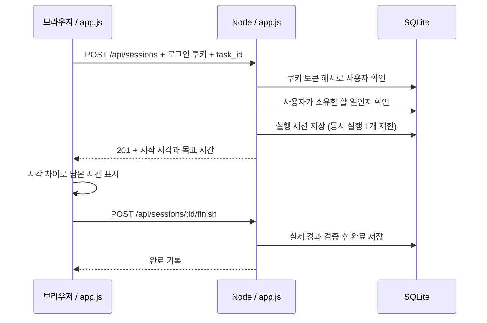
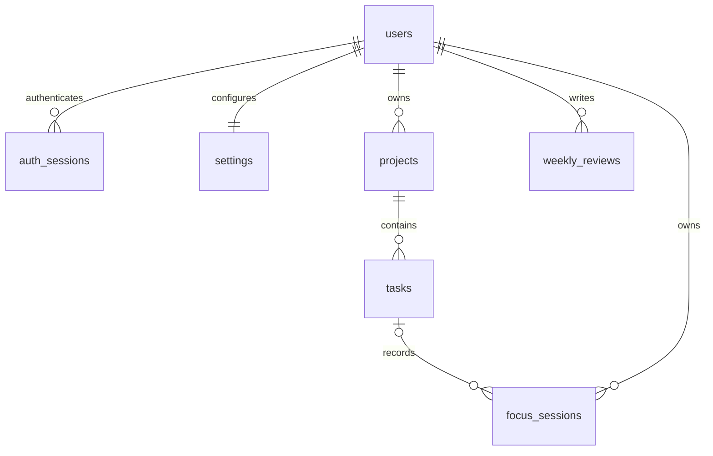

# 실제 코드로 이해하는 구조

## 1. 한 번의 요청이 지나가는 길



**프론트엔드**는 보이는 화면입니다. 버튼을 누르면 `fetch()`로 HTTP 요청을 보냅니다. **백엔드**는 보이지 않는 규칙을 실행합니다. 타이머가 정말 끝났는지, 내 할 일인지 검증합니다. **API**는 요청 경로, HTTP 메서드, JSON 형식, 응답 상태에 대한 약속입니다. **DB**는 서버가 꺼져도 유지할 데이터를 저장합니다.

브라우저와 서버는 같은 주소에서 제공하므로 CORS 설정이나 두 개의 개발 서버가 필요하지 않습니다. Node의 HTTP 서버 하나가 정적 파일과 `/api/*` 요청을 처리합니다.

## 2. 기술 선택과 비용

| 영역 | 선택 | 이유와 한계 |
|---|---|---|
| 프론트엔드 | HTML + CSS + ES modules | 빌드 없이 읽고 실행할 수 있음. 페이지가 커지면 컴포넌트로 분리하거나 React로 이전 |
| 백엔드 | Node.js 24, 내장 HTTP | 브라우저와 같은 JavaScript. 라우터/검증을 직접 다뤄야 함 |
| DB | SQLite, node:sqlite | 설치할 별도 DB 서버가 없음. 동기 쿼리이므로 큰 조회는 서버를 잠시 막음 |
| 인증 | scrypt + DB 세션 + HttpOnly 쿠키 | 토큰을 localStorage에 보관하지 않음. 운영 전 이메일 확인/계정 복구 필요 |
| 상태관리 | 단일 state 객체 + API 재조회 | Redux 등 별도 라이브러리 없이 소유권이 명확함. 데이터가 커지면 조회 단위와 캐싱 개선 |
| 테스트 | node:test | 추가 의존성 없이 API를 실제 HTTP로 검증 |

DB 스키마는 초기 V1용 `CREATE TABLE IF NOT EXISTS`입니다. 기존 테이블 변경은 자동으로 반영되지 않습니다. 다음 스키마 변경부터 버전별 마이그레이션 파일과 적용 이력을 도입해야 하며 기존 DB를 삭제해서 해결하면 안 됩니다.

## 3. DB 관계



| 테이블 | 주요 열 | 제약/역할 |
|---|---|---|
| users | id, email, name, password_hash, created_at | email UNIQUE, 비밀번호 원문 저장 금지 |
| auth_sessions | token_hash, user_id, expires_at | 7일 만료, 로그아웃 시 삭제, 원문 토큰 대신 SHA-256 해시 저장 |
| settings | user_id, focus_minutes, short_minutes, long_minutes, long_every | 사용자당 1행, 분 단위 정수 범위 제한 |
| projects | id, user_id, title, color | 소유자 필터로 조회 |
| tasks | id, user_id, project_id, title, estimated, done | 실제 완료 수는 세션에서 계산하므로 값 불일치를 피함 |
| focus_sessions | id, user_id, task_id, kind, status, target_seconds, elapsed_seconds, started_at, running_since, ended_at | 사용자당 running/paused 행 1개만 허용하는 부분 UNIQUE 인덱스 |
| focus_sessions의 회고 열 | mood, distraction, note | V1은 세션당 회고 1개라 별도 테이블 없이 보관 |
| focus_sessions의 스냅샷 열 | task_title, project_title, project_color | 할 일 삭제/이름 변경 뒤에도 당시 기록 보존 |
| weekly_reviews | user_id, week_start, wins, challenges, next_week, updated_at | (user_id, week_start) 복합 기본키 |

날짜 시각은 epoch milliseconds 정수로 저장합니다. 기간 조회는 `[시작, 다음 기간 시작)`으로 처리합니다. 통계는 한국 시간 기준입니다. 프로젝트를 삭제하면 그 할 일은 삭제되지만 과거 세션은 `task_id=NULL`과 이름 스냅샷으로 남습니다. 계정을 삭제하면 모든 소유 데이터를 함께 삭제합니다.

## 4. 인증과 인가

가입 시 랜덤 salt와 scrypt로 비밀번호를 해시합니다. 로그인 시 같은 방식으로 계산한 결과를 일정 시간 비교 함수로 검사합니다. 로그인 성공 시 32바이트 랜덤 토큰을 쿠키로 보내고 DB에는 토큰 해시만 저장합니다.

`HttpOnly`는 프론트엔드 JavaScript의 쿠키 읽기를 막고, `SameSite=Strict`는 다른 사이트에서 쿠키가 함께 전달되는 것을 제한합니다. 변경 요청은 정확한 Origin과 사용자 정의 헤더도 확인합니다. 외부 Origin에 CORS 허용 헤더를 주지 않습니다. HTTPS 환경에서는 Secure 쿠키를 사용합니다.

로그인은 **인증**입니다. `WHERE id=? AND user_id=?`로 소유권을 확인하는 것은 **인가**입니다. 화면에서 버튼을 숨겨도 직접 API를 호출할 수 있으므로 권한 검사는 항상 서버에 있어야 합니다. SQL은 값을 문자열로 이어 붙이지 않고 매개변수로 바인딩합니다. API의 테이블 이름은 서버에 고정된 목록만 사용합니다.

## 5. 상태관리와 시간

프론트엔드 `state`는 현재 화면, 선택된 할 일, 타이머 종류, 서버에서 받은 데이터를 보관합니다. 저장이 필요한 정보는 DB가 정본이고, 화면 상태는 새로고침 때 서버에서 다시 받습니다. 로그인 토큰을 브라우저 저장소에 복제하지 않습니다.

```text
실행 경과 = 누적 실행 초 + floor((현재 시각 - running_since) / 1000)
남은 시간 = max(0, 목표 초 - 실행 경과)
```

브라우저는 서버 시각과의 차이를 보정해 표시합니다. 서버도 동일 규칙으로 검증하므로 브라우저가 빨리 완료 요청을 보내도 완료되지 않습니다. 일시정지 시 누적 초를 저장하고 `running_since`를 비웁니다. 재개 시 새 기준 시각을 저장합니다. 초 단위로 내림하므로 매 일시정지에서 1초 미만 시간이 버려질 수 있습니다.

종료 시각은 서버가 완료를 발견한 시간이 아니라 실제 목표 시간이 다 찬 시각으로 계산합니다. 따라서 밤새 브라우저를 꺼 두었다가 아침에 열어도 원래 종료한 날짜에 기록됩니다. DB 부분 UNIQUE 인덱스는 여러 탭에서 동시에 시작하는 상황도 차단합니다. 종료된 세션에 대한 완료 요청은 같은 결과를 돌려줍니다.

브라우저는 15초마다 실행 상태만 동기화합니다. 주간 회고 입력 중에는 폼을 다시 그리지 않습니다. 통계와 최근 기록은 화면 이동/저장 시 다시 조회합니다.

## 6. 집계의 의미

- 집중 시간: 종료된 집중 세션의 elapsed_seconds 합. 중단된 집중도 포함.
- 완료 횟수: kind=focus이고 status=completed인 행 수.
- 평균 집중도: 평가를 입력한 집중 세션만 평균. 입력하지 않은 값은 0이 아니라 제외.
- 예상 대비 실제: 할 일별 예상 횟수와 전체 누적 완료 횟수. 기간 통계와 범위가 다름을 화면에 명시.
- 프로젝트 집계: 당시 프로젝트 이름 기준. 동일 이름의 프로젝트는 통계에서 합쳐짐. 향후 프로젝트 영구 ID 스냅샷으로 구분 가능.
- 주간 회고: 자동 생성 요약문 대신 실제 주간 집계 + 사용자 작성 회고.
- 긴 휴식: 전체 완료 집중 횟수의 나머지로 제안. 완료 기록 삭제 시 제안 순서도 다시 계산.

## 7. 다음 리팩터링 시점

현재 한 파일에 모은 API 라우팅은 규모가 커지면 auth/projects/tasks/sessions/reports 라우터로 분리합니다. UI도 화면별 ES module로 나눌 수 있습니다. V2 보상 지급 시에는 세션 완료와 보상 원장을 하나의 DB 트랜잭션에서 처리하고, `reward_events.session_id`에 UNIQUE 제약을 둡니다. 실제 이용자가 늘면 통계의 전체 기록 조회를 SQL 기간 집계/페이지네이션으로 바꿉니다.
